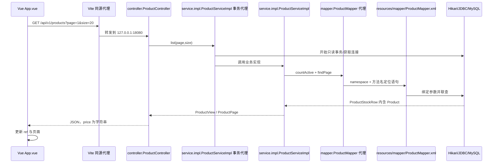

# 第二步代码详解：Vue → MVC 分层 → MyBatis XML → MySQL

> 历史说明（2026-10-18）：本文描述 `step-02 attempt-07` 的冻结状态，正文中的“当前/本轮”均指该次尝试。工程已继续 `step-03`，当前恢复请读 [step-03 HANDOFF](../step-03/HANDOFF-step-03.md) 并查询 SQLite。完整历史资料和证据见 [冻结目录](../history/step-02/attempt-07/)。当前不再维护 mindmap。

当前文档经过第二步 attempt-07 一致性审校，业务实现沿用 attempt-06：用户将展示语言统一交给前端。后端仅返回既有稳定 code、HTTP 状态及固定安全中文兜底 message；没有业务语言解析、译文资源或自定义语言响应头，api.ts 不导入语言状态或显式设置 Accept-Language。Vue 根据错误码本地翻译，保留即时切换、getJson 两阶段处理、结构校验及取消保护。MySQL schema、种子、商品原文和 CNY 精度不变。attempt-01 至 attempt-06 均已冻结于 history，历史通过不替代当前验证，完成状态以 SQLite 与本轮 HANDOFF 为准。

建议先运行商品页面，再按同一请求顺序阅读：

1. [后端逐段讲解](BACKEND-CODE-GUIDE.md)：分层、Entity/DTO/VO、依赖注入、XML 绑定、结果映射、事务与连接池。
2. [前端逐段讲解](FRONTEND-CODE-GUIDE.md)：ref/computed、请求状态、取消与竞态、字符串金额。
3. [getJson 专课](GETJSON-CODE-GUIDE.md)：请求头与响应体两个阶段、JSON 解码与运行时类型校验、错误优先级。
4. [实际问题与 XML 排错入口](OBSERVED-PITFALLS.md)：区分历史故障、当次问题与未执行实验。
5. [结构检查与优化报告](STRUCTURE-REVIEW.md)：哪些调整有实际依据、为何这样组织、哪些复杂度暂不引入。
6. [多语言逐段讲解](I18N-CODE-GUIDE.md)：类型化词典、参数插值、响应式语言、错误即时翻译、偏好存储和生产边界。
7. [开发上下文](../DEVELOPMENT-CONTEXT.md)：新对话恢复入口、台账权威与已确认的产品决定。
8. [错误码与前端统一翻译](ERROR-CODE-I18N-GUIDE.md)：安全后端错误、code/apiCode、前端词条、错误即时重译及下一位 agent 的新增报错流程。
9. [文档与项目一致性审查](DOCUMENTATION-AUDIT.md)：子 Agent 核对范围、实际冲突、历史边界、校正入口与验证证据。

## 一次请求的真实顺序

XML 启动时解析为 MappedStatement；图中的定位表示查找已注册语句，并非每次请求重读磁盘 XML。

## 核心代码阅读任务

以下路径从 services/commerce 开始：

| 源码 | 观察目标 |
|---|---|
| src/main/java/lab/commerce/controller/ProductController.java | HTTP 参数进入 Service 接口 |
| src/main/java/lab/commerce/service/ProductService.java | 业务契约 |
| src/main/java/lab/commerce/service/impl/ProductServiceImpl.java | 事务、分页、详情不存在判断 |
| src/main/java/lab/commerce/entity/Product.java | product 表的 JavaBean |
| src/main/java/lab/commerce/dto/ProductStockRow.java | 内嵌商品、库存与映射行标识 |
| src/main/java/lab/commerce/vo/ProductView.java | DTO 转换为对外 JSON 模型 |
| src/main/java/lab/commerce/mapper/ProductMapper.java | 方法与 @Param 名称 |
| src/main/resources/mapper/ProductMapper.xml | namespace、id、resultMap、association、sql/include |
| src/main/resources/application.yml | mapper-locations 与连接池 |
| src/main/java/lab/commerce/exception/GlobalExceptionHandler.java | 4 个稳定错误码、HTTP 状态和固定安全兜底 message |

找出 XML 的 LIMIT #{limit} OFFSET #{offset}，与接口 @Param 对照。找出 columnPrefix 怎样将 product_id 写入 Product.id，以及顶层 productId 如何区分库存相同的商品。

找到 price.toPlainString() 与前端 formatPrice()，确认没有中途转换成 double/Number。找到实现类上的 @Transactional，说明它与数据库 SELECT 权限的区别。

## 正常输出与失败实验

列表、详情、金额与空页继续原有契约。资源不可用为 503，SQL/映射类服务器错误为 500，并且不向客户端暴露 SQL。attempt-03 的 26 项 Java 测试/停库恢复和 attempt-04 的 43 项前端测试属于历史证据。attempt-05 的 Java 49 项和前端 45 项也属于已归档历史。attempt-06 简化异常处理和请求层语言耦合，完成 Java 38 项验证；本轮 attempt-07 仅审校文档，重跑前端/台账测试、构建、真实 API/MySQL 查询和浏览器，未重跑 Java。具体成绩和边界见 [HANDOFF](HANDOFF-step-02.md)。

当前请求层区分：网络或响应体读取失败、10 秒超时、调用方主动取消、非 2xx HTTP 错误、成功响应的坏 JSON、成功 JSON 的错误结构。错误数据在写入 Vue 状态前被拒绝。正常的空列表 `items=[]、total=0` 仍能通过。

可运行实验包括分页 400、商品不存在 404、空页 200。XML namespace、语句 id、资源路径、转义的破坏实验只在隔离副本做。讲解中的动态 SQL 搜索是未实现的教学示例。

## 生产边界

- 当前只有本地公开商品查询，没有订单、扣库存、登录、缓存、消息或智能服务。
- XML 改善 SQL 组织，不自动解决性能、注入、N+1 或事务问题。
- Entity 不直接返回前端，库存属于联查 DTO，price 在 VO 转为字符串。
- Vite 代理用于开发，生产需静态资源托管与反向代理。
- TypeScript 类型在编译后移除；当前 getJson 通过 isProduct/isProductPage 对商品响应做运行时检查，未声明全面实现 JSON Schema 校验。
- 只读事务不能代替数据库权限，也不跨服务自动生效。
- 后端自定义错误不随语言头变化；所有展示语言由前端统一维护。新增报错按根 AGENTS 和错误码指南同步安全 code/status/message、前端词条/映射、测试与台账，不恢复旧语言资源。

## 小练习

1. 手算 page=2、size=1 的 offset，沿接口、XML、JSON 核对结果。
2. 解释为何 Product 有 status，ProductView 没有；为何库存放在 DTO。
3. 画出 namespace + 方法名如何定位 findById，再画出 SQL 列如何进入 JavaBean。
4. 列出 keyword 搜索的分层改动，暂不实现；不要只改列表而遗漏 count。
