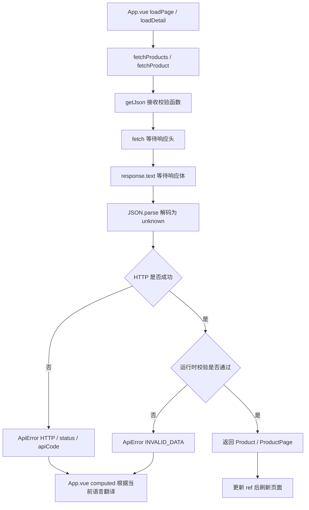

# getJson 专课：把未知的网络数据变成可信的页面输入

> 历史说明（2026-10-18）：本文描述 `step-02 attempt-07` 的冻结状态，正文中的“当前/本轮”均指该次尝试。工程已继续 `step-03`，当前恢复请读 [step-03 HANDOFF](../step-03/HANDOFF-step-03.md) 并查询 SQLite。完整历史资料和证据见 [冻结目录](../history/step-02/attempt-07/)。当前不再维护 mindmap。


对应源码：`E:\ai_agent_learning\java_python\web\src\api.ts`。当前文档经 step-02 attempt-07 审校，代码实现沿用 attempt-06；曾依赖语言状态的历史版在 `docs/history/step-02/attempt-05/web/src/api.ts`。本文片段以当前源码为准，实际测试成绩见当次验收证据与 [HANDOFF](HANDOFF-step-02.md)。

## 1．业务场景：为什么值得修改

商品页面需要“得到正确商品，或者显示可理解的错误”。attempt-03 补上读取与结构校验，attempt-04 增加三语 UI，attempt-05 曾让后端管理报错语言；attempt-06 按用户决定取消这层耦合，本轮仅审校文档。当前请求层只传输数据，展示语言统一由前端词典负责；商品原文保持不变。页面保存错误对象，不能只保存收到时的一段译文，否则切换语言后已有错误不会自然更新。

例如 HTTP 200、正文 `{}` 是合法 JSON，却没有 items。当前函数继续在写入 Vue 状态前拒绝它；错误则使用小型 ApiError 保存稳定 code、HTTP status 和服务端 apiCode，由页面在渲染时翻译。仍使用原生 fetch、AbortSignal、JSON.parse，没有新增请求库或自动重试。

## 2．核心代码逐段解释

### 2.0 错误也是有结构的数据

```ts
export type ApiErrorCode = 'TIMEOUT' | 'NETWORK' | 'INVALID_JSON' | 'INVALID_DATA' | 'HTTP'

// Keep diagnostic messages separate from the stable codes used by the translated UI.
export class ApiError extends Error {
  readonly code: ApiErrorCode
  readonly status?: number
  readonly apiCode?: string

  constructor(code: ApiErrorCode, message: string,
    details: { cause?: unknown; status?: number; apiCode?: string } = {}) {
    super(message, { cause: details.cause })
    this.name = 'ApiError'
    this.code = code
    this.status = details.status
    this.apiCode = details.apiCode
  }
}
```

code 描述请求在哪个阶段失败；status 保存可用的 HTTP 状态；apiCode 是服务端 JSON 中的稳定业务错误码。`?` 表示属性可选，网络连接失败时本来就没有 HTTP 状态。

这个类没有发请求或翻译文字，只保存错误数据。请求层本地生成的诊断 message 仍为中文；HTTP 错误的 message 保存服务端固定安全中文文案。页面不直接显示它，而根据 code/apiCode 使用当前语言词条。请求函数不再导入 useI18n，也不显式设置 Accept-Language；商品模型、结构校验、取消和超时机制不变。

### 2.1 输入、泛型与类型谓词

```ts
async function getJson<T>(
  path: string,
  signal: AbortSignal,
  validate: (value: unknown) => value is T,
): Promise<T> {
```

| 部分 | 含义 |
|---|---|
| async / Promise<T> | 成功时得到 T，失败时 Promise 被拒绝 |
| path | 相对请求路径，当前由列表或详情函数构造 |
| signal | 页面用来取消旧请求 |
| unknown | 网络数据尚未证明符合业务结构 |
| validate | 真正执行运行时检查的函数 |
| value is T | 告诉 TypeScript：检查为 true 时，可以将这个值收窄为 T |

`value is T` 叫类型谓词。类型标注编译后会被擦除，但 validate 里的 if、typeof、正则和数组判断会留在 JavaScript 中执行。编译器信任谓词的声明，因此校验函数自身也需要认真编写和测试。

详情调用现在是：

```ts
export function fetchProduct(id: number, signal: AbortSignal) {
  return getJson(`/api/v1/products/${id}`, signal, isProduct)
}
```

TypeScript 根据 `isProduct` 的类型谓词推断 T 是 Product，所以没有显式写 `<Product>`。App.vue 仍按原来的 `await fetchProduct(id, controller.signal)` 调用。

### 2.2 请求头和响应体是两个异步阶段

```ts
const timeoutSignal = AbortSignal.timeout(10_000)
const requestSignal = AbortSignal.any([signal, timeoutSignal])
let response: Response
let text: string
try {
  response = await fetch(path, {
    signal: requestSignal,
    headers: { Accept: 'application/json' },
    cache: 'no-store',
  })
  // Receiving headers does not finish the request: reading the body can fail too.
  text = await response.text()
} catch (error) {
  if (signal.aborted) throw error
  if (timeoutSignal.aborted) {
    throw new ApiError('TIMEOUT', '商品服务响应超时，请稍后重试。', { cause: error })
  }
  throw new ApiError('NETWORK', '暂时无法连接或读取商品服务，请稍后重试。', { cause: error })
}
```

Accept 表达希望收到 JSON。请求层不依赖展示语言，切换语言只让 Vue 重新计算词条，不重发或修改请求。浏览器可能自行附带 Accept-Language，这与业务代码主动设置界面语言不同，当前后端自定义错误忽略该偏好。分工详见 [错误码与前端统一翻译](ERROR-CODE-I18N-GUIDE.md)。

执行过程：

1. 创建 10 秒超时信号；它与页面传来的 signal 合并，任意一个触发都可以取消请求。
2. fetch 默认发送 GET，`Accept` 表达希望得到 JSON，`no-store` 控制浏览器 HTTP 缓存。
3. fetch 的 Promise 在响应头可用时就可以完成，此时正文可能仍在传输。
4. response.text 等到完整正文文本；它也可能因断开、取消或超时而失败。
5. 两次 await 在同一 try 内，错误按取消 → 超时 → 其他连接/读取失败的顺序分类。

调用方取消时，函数把原异常抛回。App.vue 的 catch 发现自己的 controller.signal.aborted 后直接返回，不把正常切换商品显示为故障。

超时通过保存下来的 timeoutSignal.aborted 判断，不依赖异常必须具有某个固定 name。`cause` 保留底层异常供调试；页面识别 TIMEOUT 或 NETWORK 再翻译提示，不直接显示外层中文 message 或底层异常。

这里 10 秒是 AbortSignal.timeout 管理的等待期限，不是服务器的事务超时，也不能中断之后同步执行的 JSON.parse。浏览器挂起等情况会影响其计时，生产时还需要服务端和网关自己的超时约定。

### 2.3 文本解码与 HTTP 错误分开

```ts
const httpMessage = `商品服务请求失败（${response.status}），请重试。`
let body: unknown
try {
  body = JSON.parse(text)
} catch (error) {
  // An HTML error page must not hide the HTTP status behind a JSON error.
  throw new ApiError(response.ok ? 'INVALID_JSON' : 'HTTP',
    response.ok ? '商品服务返回了无法解析的 JSON，请刷新重试。' : httpMessage,
    { cause: error, status: response.status })
}
if (!response.ok) {
  const message = isObject(body) ? body.message : undefined
  const apiCode = isObject(body) && typeof body.code === 'string' ? body.code : undefined
  throw new ApiError('HTTP', typeof message === 'string' && message.trim() ? message : httpMessage,
    { status: response.status, apiCode })
}
```

`JSON.parse` 只负责把 JSON 文本转成值，可能得到对象、数组、字符串、数字、布尔值或 null。它不认识 Product，也不判断价格是不是字符串。

HTTP 非 2xx 通常不让 fetch 自动 reject。当前代码显式检查 response.ok，并区分两类信息：

- HTTP 状态和字符串 body.code：用于页面选择翻译；例如 DATABASE_UNAVAILABLE 映射到 errorDatabaseUnavailable。
- 字符串 body.message：只保留在 ApiError.message 作为诊断和旧测试兼容，页面不直接展示；缺失时使用带状态码的诊断提示。

反向代理返回 HTML 503 时，code 为 HTTP、status 为 503，界面使用当前语言的通用 HTTP 提示；不会误报成成功数据的 JSON 格式错误。HTTP 200、正文是坏 JSON 时，code 为 INVALID_JSON。

先等待正文的设计还有一个优先级：若头部已收到 503、正文却一直不结束，最终会显示超时；它没有声称在未读完正文时就完成 HTTP 错误处理。

### 2.4 最后才允许数据进入页面

```ts
if (!validate(body)) {
  throw new ApiError('INVALID_DATA', '商品服务返回的数据格式不符合约定，请刷新重试。')
}
return body
```

validate 为 false 时立刻退出。执行到 return，TypeScript 已将 body 从 unknown 收窄为 T，不需要 `as T`。

对比三种操作：

| 操作 | 什么时候发生 | 是否检查实际数据 |
|---|---|---|
| TypeScript interface | 开发/构建类型检查 | 不检查网络正文 |
| JSON.parse | 浏览器运行时 | 检查 JSON 语法并解码 |
| isProduct / isProductPage | 浏览器运行时 | 检查业务字段结构与部分取值规则 |

## 3．校验函数怎样保护边界

### 3.1 先判对象和整数

```ts
function isObject(value: unknown): value is Record<string, unknown> {
  return typeof value === 'object' && value !== null && !Array.isArray(value)
}

function isIntegerAtLeast(value: unknown, minimum: number): value is number {
  return typeof value === 'number' && Number.isSafeInteger(value) && value >= minimum
}
```

`typeof null` 也是 object，因此必须排除 null；数组也不符合当前商品对象约定。Record<string, unknown> 让后续代码可以安全读取未知字段，再继续检查字段类型。

Number.isSafeInteger 除了拒绝小数，还拒绝超出 JavaScript 安全整数范围的数。JSON 数字解析使用 JavaScript Number；大整数可能在校验之前就已失去精度，因此未来需要更大 ID 时应把两端契约改成字符串。

### 3.2 商品必须具备哪些字段

```ts
function isProduct(value: unknown): value is Product {
  return isObject(value)
    && isIntegerAtLeast(value.id, 1)
    && typeof value.sku === 'string'
    && typeof value.name === 'string'
    && typeof value.description === 'string'
    && typeof value.price === 'string'
    && /^[0-9]+(?:\.[0-9]+)?$/.test(value.price)
    && isIntegerAtLeast(value.availableStock, 0)
}
```

id 必须是安全正整数，库存可以是 0。price 必须是非负十进制字符串，例如 `"129.90"`，不能是数字 129.9、负数文本或指数表示。

正则沿用当前 OpenAPI 契约，允许整数文本和任意非空小数位；它没有限制为两位，也没有限制金额上限。实际数据目前来自 MySQL DECIMAL(12,2)。字符串字段允许空字符串，额外字段不拒绝；这些都是当前范围，不能说已经执行了所有业务校验。

### 3.3 列表不能只检查 items 是数组

```ts
function isProductPage(value: unknown): value is ProductPage {
  return isObject(value)
    && Array.isArray(value.items)
    && value.items.every(isProduct)
    && isIntegerAtLeast(value.page, 1)
    && isIntegerAtLeast(value.size, 1)
    && isIntegerAtLeast(value.total, 0)
    && value.items.length <= value.size
    && value.items.length <= value.total
}
```

every 确保每一个元素都是合法商品；`[]` 的 every 结果为 true，所以空页仍可通过。页码、每页数量为安全正整数，total 为安全非负整数；当前返回项数不能超过 size 或 total。

这里没有重新实现后端分页规则的全部业务约束，例如请求上限仍由 Java 校验；也没有保证响应 page 一定等于调用时请求的 page，或每页一定填满。保持这个范围有助于避免两端复制大量业务规则。

## 4．调用链与底层原理



异步等待允许浏览器处理其他任务；Promise 后续逻辑通过事件循环继续。JSON.parse 和校验函数是同步执行，响应特别大时仍会占用主线程。当前 20 件商品一页足够小；本轮没有引入 Web Worker 或流式解析。

## 5．正常输出与错误优先级

正常 HTTP 200 商品 `price:"129.90"、availableStock:10` 通过后，页面显示 `¥129.90`。正常空列表通过后，中文显示“还没有商品”，英文显示“No products yet”，日文显示“商品はまだありません”。界面翻译不改变商品内容或人民币金额。

| 情况 | 当前处理 |
|---|---|
| 页面主动 abort | 原异常继续抛出，页面根据取消标记忽略 |
| 响应头或正文阶段超时 | 商品服务响应超时 |
| 非取消、非超时的连接/正文读取失败 | 暂时无法连接或读取商品服务 |
| 非 2xx、JSON 有已知业务 code | ApiError 保存 apiCode，页面映射当前语言词条 |
| 非 2xx、无已知 code 或坏 JSON | 保留 HTTP 状态码，页面使用当前语言通用提示 |
| 2xx、坏 JSON 或空正文 | 无法解析 JSON |
| 2xx、JSON 合法但不符合业务结构 | 数据格式不符合约定 |

JSON `null` 语法合法，因此归入数据格式错误。当前两个查询接口约定成功时必须返回 JSON 业务对象，204 空正文也会被拒绝，这适用于当前接口。

页面保存 ApiError 对象，由 computed 在渲染时调用 t；即使错误已经出现，切换语言也能立即更新提示。完整实现见 [I18N 专课](I18N-CODE-GUIDE.md)。

## 6．失败实验：把问题复现得可观察

在测试里改响应，不修改真实商品表。测试源码位于 `web/tests/api.test.mjs`，使用 Node 24 内置测试运行器，可直接加载当前 TypeScript 源码：

```powershell
npm --prefix E:\ai_agent_learning\java_python\web test
```

1. HTTP 200 返回 `{}`：JSON 解析成功，运行时结构检查失败。
2. 商品 price 改成数字 129.90：字段检查失败；改回 `"129.90"` 后成功。
3. HTTP 503 返回 HTML：提示含 503，不显示成功数据解析失败。
4. HTTP 200 返回 HTML：提示无法解析 JSON。
5. 让 fetch 已返回 Response，正文读取 Promise 再超时或取消：验证两阶段都能正确分类。
6. 返回 `items:[]、total:0`：应正常成功，不把无数据当故障。

普通响应、HTTP 和坏数据分支使用请求替身；头部/正文阶段的取消与超时使用本机临时 HTTP 服务器，真实 fetch、Response 正文读取和取消仍然执行。测试确认应用创建 10_000 毫秒超时，再临时将等待缩短为 150 毫秒，避免每次测试等 10 秒。它验证分支与配置，不代表真实网络一定在指定毫秒到达；真实页面、真实 Java/MySQL 的正常链路另外验证。

## 7．生产问题与当前边界

- 当前仍使用现代浏览器 AbortSignal.any/timeout；确定要支持旧浏览器时再选择兼容方案。
- response.text 会先把正文完整放入内存，当前没有实现体积限制。大量文档、文件上传或 RAG 流式响应应另订传输协议和上限，不能直接套用此函数。
- 手写校验有测试保护，接口增长后可评估以契约生成类型与校验，避免 OpenAPI 和前端规则漂移；本轮没有引入完整 schema 库。
- 页面只显示本地词条翻译，不直接展示服务端 message。message 仍存在诊断错误对象里，生产服务端同样不能把堆栈、SQL、密钥放进响应，也不应随意把错误对象完整发送到日志平台。
- 取消或超时不等于服务端已经撤销操作。当前 GET 无业务写入；未来订单 POST 需要独立的幂等和结果查询设计。
- 没有自动重试，保留当前页面人工重试；新增 ApiError 只支持错误分类与翻译，没有增加认证、缓存或拦截器框架。

## 8．小练习

1. 解释 `JSON.parse('null')` 为什么成功，isProduct 为什么返回 false。
2. 删除商品里的 description 字段，推断是哪个条件拒绝，再用测试验证。
3. 比较“503 + HTML”与“200 + HTML”提示为什么不同。
4. 写出 value is T 和 as T 的区别，再解释为什么类型谓词实现错误也会让程序不安全。
5. 在 Network 面板找一次真实详情请求，标出请求、响应头、正文和 Vue 状态更新的位置。
